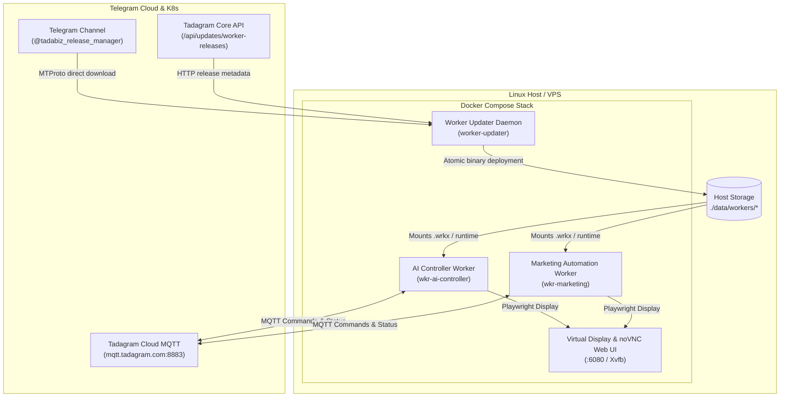

# 🐧 Tadagram Worker Portal for Linux

[](VERSION)
[]()
[]()
[]()

Production-grade Headless Worker Portal, process supervisor, and continuous auto-updater stack for hosting **Tadagram Distributed Workers** on Linux VPS and bare-metal servers.

---

## 📑 Architecture Overview



---

## 🚀 Quick Start (1-Line Server Installation)

Run this on any clean Ubuntu 20.04/22.04/24.04 or Debian 11/12 VPS:

```bash
curl -fsSL https://raw.githubusercontent.com/Tadagram/biztada-portal-release/main/scripts/install.sh | sudo bash
```


This automated installer:
1. Installs Docker Engine & Compose plugin if not present.
2. Clones the deployment into `/opt/tadagram-worker-portal`.
3. Sets up systemd service `tadagram-worker-portal.service` for auto-boot.
4. Boots the Docker Compose stack with background auto-updating.

---

## 🛠 Manual Installation & Configuration

### 1. Clone or Extract Release
```bash
mkdir -p /opt/tadagram-worker-portal
cd /opt/tadagram-worker-portal
# Extract release tarball or copy files
```

### 2. Configure Environment (`.env`)
```bash
cp .env.example .env
nano .env
```

| Variable | Description | Default |
| :--- | :--- | :--- |
| `CORE_API_URL` | Backend Core API URL | `https://business.tadagram.com` |
| `CORE_API_TOKEN` | Bearer JWT / API Token for private downloads | *Empty* |
| `TELEGRAM_API_ID` | Telegram App API ID for fast-path CDN MTProto download | `0` |
| `TELEGRAM_API_HASH` | Telegram App API Hash | *Empty* |
| `TELEGRAM_RELEASE_CHANNEL` | Channel username where release files are published | `tadabiz_release_manager` |
| `CHECK_INTERVAL_SECONDS` | Interval between worker update checks | `1800` (30m) |
| `MQTT_HOST` | Tadagram Cloud MQTT Broker host | `mqtt.tadagram.com` |
| `MQTT_PORT` | Tadagram Cloud MQTT Broker TLS Port | `8883` |

### 3. Launch the Stack
```bash
docker compose up -d --build
```

---

## 🔄 Automated Update Mechanism

The built-in `worker-updater` service continuously synchronizes with the Telegram Release Channel and Core API:

1. **Detection**:
   - Matches filename conventions:
     - `wkr-marketing-linux_v1.2.3.wrkx`
     - `wkr-marketing_linux_v1.2.3.wrkx`
     - `wkr-marketing_v1.2.3-linux.wrkx`
     - `wkr-marketing_v1.2.3.wrkx` (Universal)
   - Checks `data/workers/{worker_id}/worker.json` or `version.txt` to read current semver.
2. **Download & Integrity**:
   - Downloads directly from Telegram CDN via MTProto (fastest path) or via HTTP fallback.
   - Verifies SHA-256 payload integrity checksums.
3. **Atomic Rollout**:
   - Backs up existing `.wrkx` file to `.wrkx.bak`.
   - Atomically replaces worker executable.
   - Restarts corresponding Docker container with zero operator intervention.

---

## 🖥 Remote Visual Supervision (noVNC)

Playwright-driven workers (such as `wkr-ai-controller` and `wkr-marketing`) render their browser sessions to the headless virtual X11 server:

- **Web Browser URL**: `http://<YOUR_SERVER_IP>:6080/vnc.html`
- **Resolution**: 1920x1080 Full HD
- View live browser navigations, anti-bot interactions, and real-time marketing campaigns.

---

## 🎮 Service Management CLI

A helper script is provided at `scripts/service.sh`:

```bash
# Check running status of all workers & updater
./scripts/service.sh status

# View live consolidated logs
./scripts/service.sh logs

# View logs for a specific worker
./scripts/service.sh logs wkr-ai-controller

# Force an immediate check for worker updates
./scripts/service.sh update

# Restart stack
./scripts/service.sh restart
```

---

## 📦 GitHub Release & Version Bumping

To build a release tarball and push a new version:

### On Linux / macOS:
```bash
./scripts/release.sh 1.0.1
```

### On Windows PowerShell:
```powershell
.\scripts\release.ps1 -NewVersion 1.0.1
```

Then create the release with GitHub CLI:
```bash
gh release create v1.0.1 tadagram-worker-portal-linux-v1.0.1.tar.gz --title "Worker Portal Linux v1.0.1" --notes-file CHANGELOG.md
```
